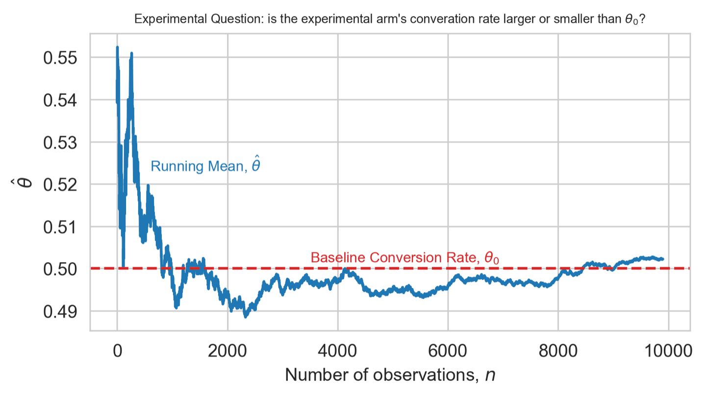
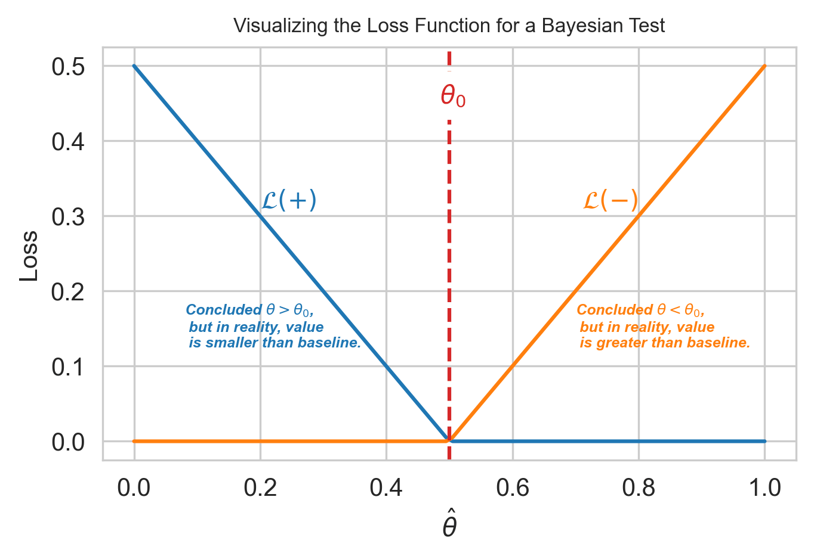
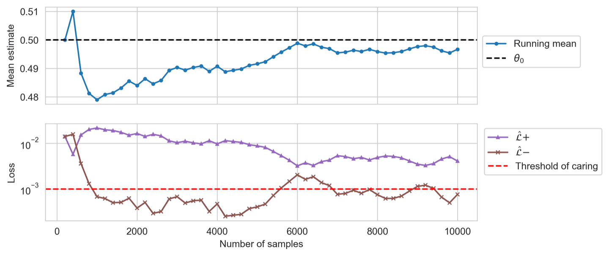
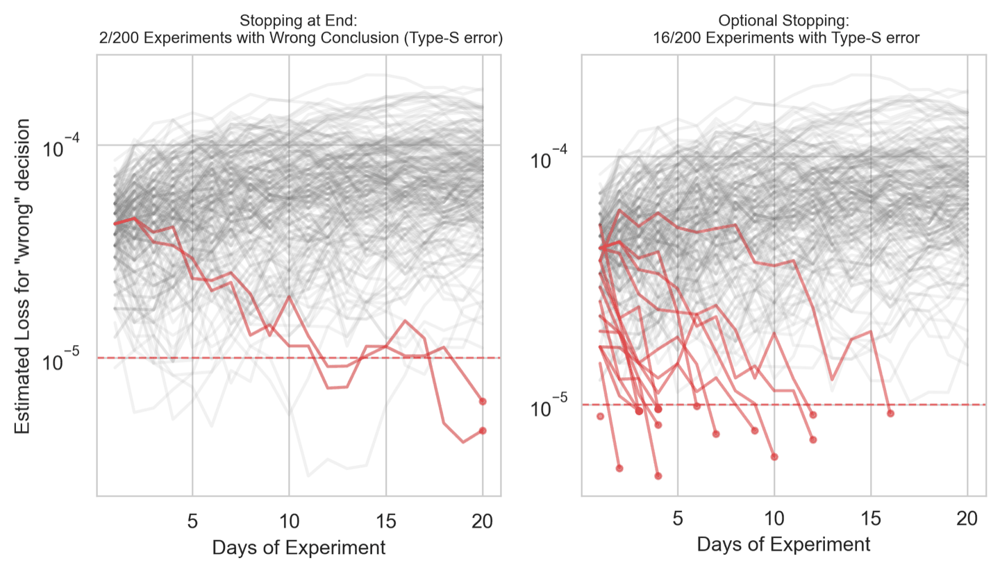
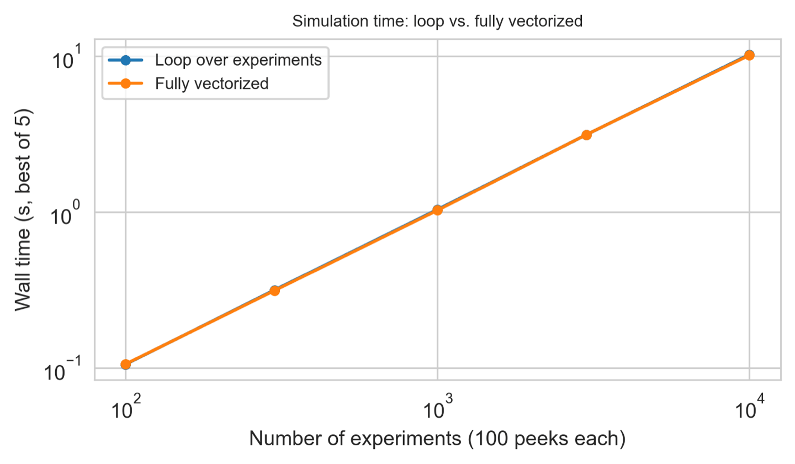
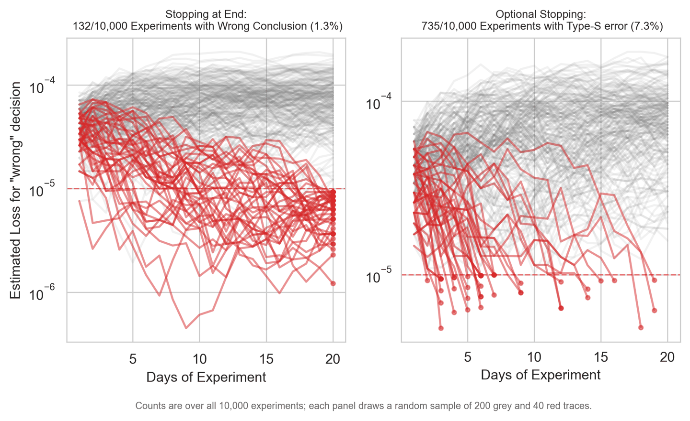

## TL;DR

This is the first of two posts on how Bayesian A/B tests behave under optional stopping ("peeking"). We use a simplified one-arm experiment where the Bayesian expected loss can be computed analytically *and* vectorized. That lets us build a simulator that runs a thousand experiments in about a second, and we use it to reproduce [David Robinson's](http://varianceexplained.org/r/bayesian-ab-testing/) finding that peeking inflates the Type-S error rate.

In part 2 we'll use the simulator to study credible intervals, calibration, and Type-M and Type-S errors, and compare them against the "anytime-valid" confidence sequences of [Waudby-Smith et al.](https://arxiv.org/abs/2103.06476). Both posts are a narrower, more accessible version of a [paper](https://arxiv.org/abs/2302.10108) with coauthors, especially appendix B4. This one is also an excuse to dive into the ~~wonders~~ benefits of vectorizing your code!

## Introduction

In the past few years I've worked a fair amount on A/B testing, and have faced a question that's familiar to many data scientists: should I use Bayesian methods? 

Of course, this is fundamentally a question of philosophy - do you think of probability in terms of long run frequenies of events, or as subjective degrees of belief? There are also many practical concerns like whether or not you have prior information, sample size constraints, computational feasibility etc. I'll confess that I am personally inclined towards Bayesian thinking (especially after reading [The Signal and the Noise](https://www.goodreads.com/book/show/13588394-the-signal-and-the-noise)!), but mostly I am inclined towards practicality and **choosing methods where I understand the tradeoffs**. 

One major tradeoff worth understanding, and one that is very relevant in online A/B tests is that of ***optional stopping***, or ***"peeking"*** - basically, looking at the results of the A/B test as data accumulates, and stopping early if there is a clear winner (or loser). This is obviously important when running an online A/B test, since we all know the ~~cliche~~ truism that time is money. 

About ten years ago, when A/B testing was being newly evangelized in tech and $t$-tests were the methodology du jour, it was not well known that peeking could increase False Positive rates (Type-I errors). However, there have since been tons of [blogs](https://www.lucidchart.com/blog/the-fatal-flaw-of-ab-tests-peeking), [papers](http://library.usc.edu.ph/ACM/KKD%202017/pdfs/p1517.pdf), and [think pieces](https://blog.analytics-toolkit.com/2017/the-bane-of-ab-testing-reaching-statistical-significance/) about this issue. My favorite summary of the issue is [Evan Miller's "How Not to Run an A/B Test"](https://www.evanmiller.org/how-not-to-run-an-ab-test.html) (his entire blog is fantastic!).

One interesting suggestion towards the end of the Evan Miller's article is the following:
> With Bayesian experiment design you can stop your experiment at any time and make perfectly valid inferences. Given the real-time nature of web experiments, Bayesian design seems like the way forward.

A few others contemporaneously made this claim ([Chris Stucchio](https://www.chrisstucchio.com/blog/2014/bayesian_ab_decision_rule.html) among others), before an excellent and naunced blog from David Robinson explained that [optional stopping in Bayesian tests was not so simple](http://varianceexplained.org/r/bayesian-ab-testing/)[^1]. 

[^1]: Note that these issues have been discussed in various academic fields, e.g. [psychology](https://pubmed.ncbi.nlm.nih.gov/24659049/), so my linear historical narrative in the tech industry is definitely too simple! 

His primary observation was that Bayesian A/B tests that use a decision theoretic approach to stop the test (by bounding the expected *loss*, $\mathcal{L}$) will indeed respect this expected loss under optional stopping. But such tests aren't concerned with Type-I and Type-II error rates, and so they will not provide any meaningful guarantees on these rates.  

And so, in the spirit of David Robinson's post, I would like to offer a bit more nuance to the discussion of early stopping in Bayesian A/B tests. In particular, [modern statistical guidance](https://amstat.tandfonline.com/doi/full/10.1080/00031305.2016.1154108#.Vt2XIOaE2MN) includes favoring methods that emphasize estimation over testing, of which confidence intervals (or their Bayeisan counterparts - *credible* intervals) are of particular importance. So in this blog, we study the behavior of bayesian credible intervals under optional stopping. We also consider a few more calibration and error metrics which help deepen our understanding of how Bayesian A/B tests behave.

## Defining a Bayesian test

A key "insight" for this post is that the loss function for a single-armed experiment one arm vs. a known baseline) can be computed exactly and vectorized in numpy. Let's dive a bit deeper into what all of this means.

### Prior, Evidence and Posterior
Consider an experiment where we are measuring observations $x_i$ of some binary outcome (e.g. a conversion) with unknown mean $\theta$, and comparing this to a known baseline $\theta_0$. A view of the results as data accumulates in this experiment is shown below:

<details><summary>Plotting code</summary>

```python
import numpy as np
import matplotlib.pyplot as plt
import seaborn as sns
import matplotlib as mpl
%matplotlib inline
mpl.rcParams['figure.dpi']= 300

sns.set_style("whitegrid")

rng = np.random.default_rng(seed=1234)
draws = 10000
p = 0.505
baseline_theta = 0.5
first_observation = 100

individual_observations = rng.binomial(1, p , draws)
running_n = np.arange(draws) + 1
running_mean = individual_observations.cumsum() / running_n

fig, ax = plt.subplots(figsize=(6,3))
ax.plot(running_mean[first_observation:], color="tab:blue")
ax.axhline(0.5, linestyle='--', color='tab:red')
ax.text(3500, 0.5015, "Baseline Conversion Rate, $\\theta_0$", color='tab:red', size=8)
ax.text(600, 0.523, "Running Mean, $\hat{\\theta}$", color='tab:blue', size=8)
ax.set_title("Experimental Question: is the experimental arm's converation rate larger or smaller than $\\theta_0$?", size=7)
ax.set_xlabel("Number of observations, $n$")
ax.set_ylabel("$\hat{\\theta}$");
```

</details>



We will model this unknown mean with a Beta prior. Each observation is then drawn from a Bernoulli distribution, and after $n$ observations have been made, the fraction of successes $X_n$ will therefore follow a Binomial distribution.

$$
\begin{align}
\text{prior, }\quad \theta &\sim \text{Beta}(a_0, b_0)\\
\text{individual observations, }\quad x_i|\theta &\sim \text{Bernoulli}(\theta)\\
\text{evidence, }\quad X_n|\theta &\sim \text{Binomial}(n,\theta)
\end{align}
$$

With the usual Bayes rule, we have the posterior:
$$
P(\theta | \text{evidence}) = \frac{P(\text{evidence}|\theta)P(\theta)}{P(\text{evidence})}
$$

which, after $n$ observations with $c$ conversions follows a Beta distribution:

$$
\theta | X_n \sim \text{Beta}(a_0 + c, b_0 + n - c)
$$

### Loss Function and Stopping Rule
Given the probability model above, we still need a stopping rule for our experiment. In tech applications, [Chris Stuccio popularized a decision theoretic approach](https://vwo.com/downloads/VWO_SmartStats_technical_whitepaper.pdf) to a Bayesian A/B tests, where we:

- Define a *loss function*, which quantifies "how much we care" about making a mistake[^2].
- Compute the expected value of that loss under the posterior.
- Stop the test when the expected loss falls below a "threshold of caring", $\varepsilon$ (more on what this means later)

[^2]: For a great overview of loss functions in Bayesian inference from a programmer's perspective see [chapter five](https://nbviewer.org/github/CamDavidsonPilon/Probabilistic-Programming-and-Bayesian-Methods-for-Hackers/blob/master/Chapter5_LossFunctions/Ch5_LossFunctions_PyMC3.ipynb) of Cam Davidson Pilon's [Probabilistic Programming and Bayesian Methods for Hackers course](https://dataorigami.net/Probabilistic-Programming-and-Bayesian-Methods-for-Hackers/). 

#### The Loss Function

In our context, the loss function chosen will linearly penalize making the "wrong" decision. Note that there are two possible conclusions to the experiment, which we will denote as $\mathbf{+}$ and $\mathbf{-}$ respectively, and the loss function will differ for each. For the $\mathbf{+}$ case, we conclude that the experimental arm has a larger mean than the baseline: $\theta > \theta_0$. For the $\mathbf{-}$ case, we conclude that $\theta < \theta_0$. 

Given this definition, the loss function is defined in terms of our estimate for the mean of the experimental arm $\hat{\theta}$, and the baseline arm's conversion rate $\theta_0$ as

$$
\begin{align}
\color{blue}{\mathcal{L}(\hat{\theta}, \theta_0, \mathbf{+})} &= \max{\left(\theta_0 - \hat{\theta}, 0\right)}\\
\color{orange}{\mathcal{L}( \hat{\theta}, \theta_0, \mathbf{-})} &= \max{\left(\hat{\theta} - \theta_0, 0\right)}
\end{align}
$$

In words, if we concluded that the experimental arm had a larger mean, but the observed mean $\hat{\theta}$ is in fact smaller than the fixed baseline arm's conversion rate, $\theta_0$ (first line), then we will linearly penalize this "mistake". The second line is the vice-versa condition.

<details><summary>Plotting code</summary>

```python
theta_0 = 0.5
thetas = np.linspace(0,1,num=100)
loss_plus = np.maximum(theta_0 - thetas, np.zeros_like(thetas))
loss_minus = np.maximum(thetas - theta_0, np.zeros_like(thetas))


from matplotlib.font_manager import FontProperties

font = FontProperties()
font.set_family('serif')
font.set_name('Arial')
font.set_style('italic')
font.set_weight('bold')


fig, ax = plt.subplots(figsize=(5,3))
ax.plot(thetas, loss_plus)
ax.plot(thetas, loss_minus)
ax.text(0.485,0.45,"$\\theta_0$", size=10, color="tab:red",backgroundcolor = 'w')
ax.text(0.2, 0.31, "$\mathcal{L}(+)$", color="tab:blue")
ax.text(0.71, 0.31, "$\mathcal{L}(-)$", color="tab:orange")
ax.text(0.08, 0.125, "Concluded $\\theta > \\theta_0$, \n but in reality, value \n is smaller than baseline.", size=6, color="tab:blue", fontproperties=font)
ax.text(0.7, 0.125, "Concluded $\\theta < \\theta_0$, \n but in reality, value \n is greater than baseline.", size=6, color="tab:orange", fontproperties=font)

ax.axvline(0.5,linestyle='--', color='tab:red')
ax.set_xlabel("$\hat{\\theta}$")
ax.set_ylabel("Loss")
ax.set_title("Visualizing the Loss Function for a Bayesian Test", size=8);
```

</details>



#### Expected Loss and the Stopping Rule
As described above, we will then compute the expected value of this loss function under the posterior 

$$
\begin{align}
\color{blue}{\mathcal{\hat{L}}_{+}} := E\left[\color{blue}{\mathcal{L}(\hat{\theta}, \theta_0, \mathbf{+})}\right] &= \int^{1}_{0}  \max{\left(\theta_0 - \hat{\theta}, 0\right)}P\left(\theta \lvert X_n\right)d\hat{\theta}\\
\color{orange}{\mathcal{\hat{L}}_{-}} := E\left[\color{orange}{\mathcal{L}(\hat{\theta}, \theta_0, \mathbf{-})}\right] &= \int^{1}_{0}  \max{\left( \hat{\theta} -\theta_0, 0\right)}P\left(\theta \lvert X_n\right)d\hat{\theta}\\
\end{align}
$$
We then introduce a "threshold of caring" $\varepsilon$ which, given our linear definition of the loss function, can be interpreted as a probabilistically weighted difference in conversion rates below which we do not care about making a mistake. E.g. $\varepsilon = 0.001$ indicates we don't care about a $10\%$ chance of making a conversion rate error of 0.01. 

The ***stopping rule*** is then defined as:
> On each round of the test, compute $\color{blue}{\mathcal{\hat{L}}_{+}}$ and $\color{orange}{\mathcal{\hat{L}}_{-}}$. If $\color{blue}{\mathcal{\hat{L}}_{+}} < \varepsilon$, stop the test and conclude that the $\theta > \theta_0$. If  $\color{orange}{\mathcal{\hat{L}}_{-}} < \varepsilon$, stop the test and conclude that $\theta < \theta_0$. If both are smaller than $\varepsilon$, then both outcomes are equivalent, and the difference between $\theta$ is equivalent to $\theta_0$ within our error tolerance $\varepsilon$. Otherwise, continue the test.

#### Analytic expression for expected loss
So as we've previously alluded to, this simple "single arm" bayesian test has an expected loss function that can be computed analytically under the Beta posterior defined above. Let's see this explicitly. 

Under a posterior Beta distribution for the conversion rate $\theta$, of the form 
$$ 
\text{Beta}(a_0 + c, b_0 + n - c) \equiv \text{Beta}(\alpha, \beta) =\frac{ \theta^{\alpha - 1}(1- \theta)^{\beta - 1}}{B(\alpha, \beta)}
$$
where $B(\alpha, \beta)$ is the [Beta function](https://en.wikipedia.org/wiki/Beta_distribution). 
Given this, we have the following expression for the expected loss function
$$
\begin{align}
\color{blue}{\mathcal{\hat{L}}_{+}} &= \int^{1}_{0}  \max{\left(\theta_0 - \theta, 0\right)}P\left(\theta \lvert X_n\right)d\theta\\
&= \int^{1}_{0}  \max{\left(\theta_0 - \theta, 0\right)} \frac{\theta^{\alpha - 1} (1- \theta)^{\beta - 1}}{B(\alpha, \beta)}d\theta \\
&= \int^{\theta_0}_{0}  \left(\theta_0 - \theta\right)\frac{\theta^{\alpha - 1} (1- \theta)^{\beta - 1}}{B(\alpha, \beta)}d\theta\\
&= \theta_0 \int^{\theta_0}_{0} \frac{\theta^{\alpha - 1} (1- \theta)^{\beta - 1}}{B(\alpha, \beta)}d\theta \nonumber\\
&\quad - \frac{B(\alpha + 1, \beta)}{B(\alpha, \beta)} \int^{\theta_0}_{0} \frac{\theta^{(\alpha + 1) - 1} (1- \theta)^{\beta - 1}}{B(\alpha + 1, \beta)} d\theta\\
&= \theta_0 I_{\theta_0}(\alpha, \beta) - \frac{\alpha}{\alpha + \beta} I_{\theta_0}(\alpha + 1, \beta)
\end{align} 
$$
where $I_{x}(a,b)$ is the [regularized incomplete Beta function](https://en.wikipedia.org/wiki/Beta_function#Incomplete_beta_function).
Note that in going from line 2 to 3, we observed that the max-function restricts the integral to the region $0 \le \theta \le \theta_0$, while the fourth to fifth line is simply a replacement of the integrals with the definition of the regularized incomplete beta function, along with use of the beta function recurrence relation: 

$$
B(x+1,y) = B(x,y)\cdot \frac{x}{x+y}
$$

By a similar line of reasoning, the "other" loss function evaluates to

$$
\begin{align}
\color{orange}{\mathcal{\hat{L}}_{-}} =  \frac{\alpha}{\alpha + \beta} I_{1-\theta_0}(\beta, \alpha + 1) - \theta_0 I_{1-\theta}(\beta, \alpha)
\end{align} 
$$

> The beauty of both these mathematical functions is that our benevolent SciPy overlords have [defined and vectorized this function](https://docs.scipy.org/doc/scipy/reference/generated/scipy.special.betainc.html). This means that we have an analytically exact, vectorized Bayesian loss - a rare and precious result!

#### The implementation of our loss functions
Let's see these loss functions in python:

```python
from scipy.special import betainc

def bayesian_loss_plus(a, b, theta_zero):
  first_term = theta_zero * betainc(a, b, theta_zero)
  second_term =  betainc(a+1, b, theta_zero) * a / (a + b)
  return first_term - second_term
  
def bayesian_loss_minus(a, b, theta_zero):
  first_term =  betainc(b, a + 1, 1 - theta_zero) * a / (a + b)
  second_term = theta_zero * betainc(b, a, 1 - theta_zero)
  
  return first_term - second_term
```

### Simulating the Bayesian A/B test

Over the next few sections, we will ~~beat~~ vectorize the above loss function to death. But this blog aims to be as much a data scientist's blog as an engineering/implementation focused one. The pretty analytic expressions above don't mean anything unless we can numerically study them. So, to build intuition and motivate this process, let's start with a naive implementation of the test.

#### A Super Basic implementation. 

Any simulation of a Bayesian one-armed test will involve a few things:
1. Simulate the data generation process (draws from a bernoulli distribution)
2. Maintain the running statistics of the test
3. Compute the loss function at each step, and determine whether or not to stop the test. 

Let's do this with some basic for-loops:

```python
import numpy as np

theta_0 = 0.5       # Baseline conversion rate
theta = 0.49        # The input conversion rate of our test arm
n_samples = 10000   # The number of test subjects

# The bayesian priors
prior_alpha = 1
prior_beta = 1
bayesian_threshold_caring = 0.001

# Modern numpy best practice - 
rng = np.random.default_rng()


# Keep track of running statistics
successes = 0
failures = 0

# Conduct the experiment by sampling 
for x_i in range(n_samples):
  rand = rng.random()
  if rand < theta:
    successes += 1
  else:
    failures += 1
  
  # The sample size, and running mean
  n = x_i + 1
  theta_hat = successes / n
  
  # Compute the expected value of the loss functions
  loss_plus = bayesian_loss_plus(prior_alpha + successes, 
                                 prior_beta + failures, 
                                 theta_0)
  loss_minus = bayesian_loss_minus(prior_alpha + successes, 
                                   prior_beta + failures, 
                                   theta_0)
  
  # Apply the decision rule
  if (loss_plus <= bayesian_threshold_caring) and (loss_minus <= bayesian_threshold_caring):
    print(f"Experiment ended: both losses less than bayesian threshold")
    print(f"{n=}, {successes=}, {failures=}, {theta_hat=:.5f}, {loss_plus=:.5f}, {loss_minus=:.5f}")
    break
  if loss_plus <= bayesian_threshold_caring:
    print("Experiment ended - Conclusion: Theta > Theta_0")
    print(f"{n=}, {successes=}, {failures=}, {theta_hat=:.5f}, {loss_plus=:.5f}, {loss_minus=:.5f}")
    break
  if loss_minus <= bayesian_threshold_caring:
    print("Experiment ended - Conclusion: Theta < Theta_0")
    print(f"{n=}, {successes=}, {failures=}, {theta_hat=:.5f}, {loss_plus=:.5f}, {loss_minus=:.5f}")
    break
    
# A fallback decision
if x_i >= n_samples:
  print(f"Experiment ended - could not reach conclusion after {n_samples}")
```

```text
Experiment ended - Conclusion: Theta < Theta_0
n=116, successes=49, failures=67, theta_hat=0.42241, loss_plus=0.07719, loss_minus=0.00092
```

#### A better (vectorized) implementation
Ok great - the above implementation works. But it's awful for many reasons:

- we're doing a slow and cumbersome for-loop (this implementation is ripe for vectorization)
- We're not tracking anything and so we can't plot any trends or glean any systematic information. 
- Our code is written in a deeply non-extendable way - keeping track of a new statistic is going to be tough. 

Let's fix this by vectorizing the data generation and also keeping track of statistics along the way. We'll make some fancy plots as well. 

###### Vectorizing the data: Numpy's binomial generator
To move forward, we'll make heavy use of the numpy random number generator's [binomial distribution](https://numpy.org/doc/stable/reference/random/generated/numpy.random.Generator.binomial.html#numpy.random.Generator.binomial). Let's understand it first:

```python
import numpy as np
rng = np.random.default_rng(12345)
n, p = 1, .5  # number of trials, probability of each trial

# Setting trials, n = 1 is equivalent to draws from a bernoulli distribution
# size = 10 means to repeat the draws 10 times. 
draws = rng.binomial(n, p, size=10)
draws
```

```text
array([0, 0, 1, 1, 0, 0, 1, 0, 1, 1])
```

On average, as the number of draws increases, we can see the average of "successes" (1's) approaching the mean we input. This can be achieved in two ways - either increasing the number of trials, $n$, or increasing the number of repeated draws *size*.

```python
repeats = 10000

avg_1 = rng.binomial(repeats, p, size=1)[0]/repeats
avg_2 = rng.binomial(1, p, size=repeats).sum() / repeats

print("Avg. Number of successes with 10000 trials, 1 draw only ",avg_1)
print("Avg. Number of successes with 1 trial repeated for 1000 draws: ",avg_2)
```

```text
Avg. Number of successes with 10000 trials, 1 draw only  0.4934
Avg. Number of successes with 1 trial repeated for 1000 draws:  0.4927
```

Hopefully some bells are going off in your mind - we can use these repeated draws to simulate an experiment where data arrives sequentially. In our experiment setting:

- The number of trials, $n$ can represent the number of observations per "peek" at the data.

- Meanwhile, the number of repeats will be represented by the size parameter. 

Here is an experiment with 10 peeks at the data, with 200 observations in each peek:

```python
peeks = 10
observations_per_peek = 200

samples = rng.binomial(n=observations_per_peek, p=0.5, size=peeks)
samples
```

```text
array([118, 100, 102, 114,  98, 107,  83, 102, 105,  95])
```

The *cumulative* number of successes is simply a cumulative sum of this array, while the sample sizes are constant for each batch (and the running sample size is a cumulative sum of this)

```python
cumulative_successes = samples.cumsum().astype(float) # casting to float for convenience
running_sample_size = (np.ones(peeks) * observations_per_peek).cumsum()
cumulative_failures = running_sample_size - cumulative_successes

print("Running Sample Size:")
print(f"{running_sample_size}")
print("Cumulative successes:")
print(f"{cumulative_successes}")
print("Cumulative failures")
print(f"{cumulative_failures}")
```

```text
Running Sample Size:
[ 200.  400.  600.  800. 1000. 1200. 1400. 1600. 1800. 2000.]
Cumulative successes:
[ 118.  218.  320.  434.  532.  639.  722.  824.  929. 1024.]
Cumulative failures
[ 82. 182. 280. 366. 468. 561. 678. 776. 871. 976.]
```

Finally, we note again that the core function involved in our loss is the regularized incomplete beta function, that is fully vectorized in its scipy implementation. In fact, we can blindly re-use the function we reimplemented above, and provided the $a$ and $b$ parameters are arrays of the same size, we will get the correct results. (You can check these for yourself!)

```python
bayesian_loss_plus(a=cumulative_successes, b=cumulative_failures, theta_zero=0.5)
```

```text
array([5.92925499e-05, 3.54322202e-04, 4.37039649e-04, 4.71328971e-05,
       1.25425823e-04, 6.05719210e-05, 7.86743668e-04, 7.00719245e-04,
       4.64030577e-04, 8.08110706e-04])
```

###### The actual code
Ok after that (perhaps too) lengthy introduction to numpy array, we can simulate our test once again, in a much more principled manner:

```python
theta_0 = 0.5       # Baseline conversion rate
theta = 0.495       # The input conversion rate of our test arm
n_samples = 10000   # The number of test subjects
n_peeks = 50
observations_per_peek = n_samples // n_peeks

# The bayesian priors
prior_alpha = 1
prior_beta = 1
bayesian_threshold_caring = 0.001

rng = np.random.default_rng(12345)

# Generate data for the experiment
cumulative_successes = rng.binomial(observations_per_peek, theta, size=n_peeks).cumsum() # Size (n_peeks)
cumulative_samples = (np.ones(n_peeks) * observations_per_peek).cumsum()
cumulative_failures = cumulative_samples - cumulative_successes

# Compute the loss functions - fully vectorized!
loss_plus = bayesian_loss_plus(cumulative_successes, cumulative_failures, theta_0)
loss_minus = bayesian_loss_minus(cumulative_successes, cumulative_failures, theta_0)

# Make decisions!
decision_plus = loss_plus <= bayesian_threshold_caring
decision_minus = loss_minus <= bayesian_threshold_caring
```

<details><summary>Plotting code</summary>

```python
#plt.plot(cumulative_samples, loss_plus)
fig, axes = plt.subplots(2,1, sharex=True, figsize=(8,4))
ax1, ax2 = axes[0], axes[1]

ax1.plot(cumulative_samples, cumulative_successes/cumulative_samples, "-o", markersize=3, label="Running mean")
ax1.axhline(theta_0, ls="--", color="black", label="$\\theta_0$")
ax1.legend(bbox_to_anchor=(1.25, 0.75), loc='upper right')
ax1.set_ylabel("Mean estimate")
ax2.plot(cumulative_samples, loss_plus, "-^", color="tab:purple", markersize=3, label="$\mathcal{\hat{L}}{+}$")
ax2.plot(cumulative_samples, loss_minus,"-x", color="tab:brown", markersize=4, label="$\mathcal{\hat{L}}{-}$")
ax2.axhline(bayesian_threshold_caring, ls="--", color="red", label="Threshold of caring")
ax2.set_yscale('log')
ax2.set_xlabel("Number of samples")
ax2.set_ylabel("Loss")
ax2.legend(bbox_to_anchor=(1.3, 1.0), loc='upper right')
```

</details>



```text
<matplotlib.legend.Legend at 0x16c7099a0>
```

##### Early stopping over multiple experiments

With the above vectorized code, we can start to study multiple experiments in a time efficient manner. 

Let's reproduce a scenario similar to [David Robinson's post](http://varianceexplained.org/r/bayesian-ab-testing/) where we try to distinguish whether a $0.09\%$ conversion rate is different to a $0.1\%$ conversion rate (for our one armed test, we set $\theta_0 = 0.1\%$). We use a threshold of caring of $\varepsilon = 10^{-5}$, and use priors of $\alpha = 10$, $\beta = 9000$. 

Similar to his post, we assume an experiment that lasts 20 days, with one "peek" per day, and with a constant 10,000 observations for each day, and we will repeat this experiment 200 times. 

In particular, we study an error rate defined as concluding that the experimental arm has a conversion rate *larger* than $\theta_0$, i.e., this is a [Type-**S** (**S**ign error)](https://cran.r-project.org/web/packages/retrodesign/vignettes/Intro_To_retrodesign.html)

Along the way, let's start modularizing our implementation.

**Define Reusable Configuration and Simulation method***:

```python
from dataclasses import dataclass

@dataclass
class BayesianExperimentConfig:
  theta_0: float = 0.001       # Baseline conversion rate
  theta: float = 0.0009        # The input conversion rate of our test arm
  n_peeks: int = 20  
  observations_per_peek: int = 10000
  n_samples: int = observations_per_peek * n_peeks      # The number of test subjects


  n_experiments: int = 200

  # The bayesian priors
  prior_alpha: int = 100
  prior_beta: int = 99900
  bayesian_threshold_caring: float = 0.00001

  
# Set our seed for reproducibility
rng = np.random.default_rng(12345)
def bayesian_experiment_simulation_v1(cfg: BayesianExperimentConfig, 
                                      rng: np.random.Generator):
  """
  V1 of a single armed bayesian experiment simulation.
  
  Does a for loop over experiments, and computes bayesian losses
  for concluding that arm has 
  
  Inputs:
  -------
  cfg: BayesianExperimentConfig - a data class capturing experiment config
  rng: np.random.Generator -  a random number generator instance
  
  Outputs:
  ---------
  (loss_pluses, loss_minus): Tuple[np.array, np.array], with shapes n_experiments x n_peeks
  
  """
  loss_minuses = []
  loss_pluses = []
  
  for e in range(cfg.n_experiments):
    # Generate data for the experiment
    cumulative_successes = rng.binomial(cfg.observations_per_peek, 
                                        cfg.theta, 
                                        size=cfg.n_peeks).cumsum() # Size (n_peeks)
    cumulative_samples = (np.ones(cfg.n_peeks) * cfg.observations_per_peek).cumsum()
    cumulative_failures = cumulative_samples - cumulative_successes

    # Compute the loss functions - fully vectorized!
    loss_plus = bayesian_loss_plus(cumulative_successes + cfg.prior_alpha, 
                                   cumulative_failures + cfg.prior_beta, cfg.theta_0)
    loss_minus = bayesian_loss_minus(cumulative_successes + cfg.prior_alpha, 
                                     cumulative_failures + cfg.prior_beta,cfg.theta_0)

    # Store data for later
    loss_pluses.append(loss_plus)
    loss_minuses.append(loss_minus)
    
  return np.array(loss_pluses), np.array(loss_minuses)


def classify_experiments(loss_pluses, loss_minuses, bayesian_threshold_caring, 
                         theta, theta_zero):
  """
  Utility method to classify various experiments into those 
  that were "always correct", "wrong at end", or "wrong at an arbitrary time"
  
  """
  incorrect_losses = loss_pluses if theta < theta_zero else loss_minuses

  # Loop over experiment results and capture important information
  wrong_decisions_any_time = []
  wrong_decisions_at_end = []
  always_correct = []
  for e in range(len(loss_pluses)):
    if incorrect_losses[e][-1] < bayesian_threshold_caring:
      # The conclusion at the end of the experiment was that the experimental arm 
      # had conversion rate \theta > \theta_0
      wrong_decisions_at_end.append(incorrect_losses[e])

    if np.any(incorrect_losses[e] < bayesian_threshold_caring):
      # The conclusion was wrong at _some_ time during the experiment
      first_index_below_threshold = np.argmax(incorrect_losses[e] < bayesian_threshold_caring)
      wrong_decisions_any_time.append(incorrect_losses[e][:first_index_below_threshold+1])
    else:
      always_correct.append(incorrect_losses[e])
      
  return always_correct, wrong_decisions_at_end, wrong_decisions_any_time
```

With this reusable configuration class defined we can ***now run the simulation***

```python
rng = np.random.default_rng(12345)
config = BayesianExperimentConfig()

loss_pluses, loss_minuses = bayesian_experiment_simulation_v1(config, rng)
always_correct, wrong_at_end, wrong_any_time = classify_experiments(loss_pluses, loss_minuses,
                                                                   config.bayesian_threshold_caring,
                                                                    config.theta,
                                                                    config.theta_0
                                                                   )
```

And finally, we can plot our results!

<details><summary>Plotting code</summary>

```python
fig, axes = plt.subplots(1,2, figsize=(8,4))
ax1, ax2 = axes[0], axes[1]

days = np.arange(20) + 1

for i in range(config.n_experiments):
  ax1.plot(days, loss_pluses[i], alpha=0.1, color='tab:gray')
  
for result in wrong_at_end:
  ax1.plot(days, result, alpha=0.5, color='tab:red')
  ax1.plot(days[len(result)-1], result[-1],'o', markersize=3, alpha=0.5, color='tab:red')


for result in always_correct:
  ax2.plot(days, result, alpha=0.1, color='tab:gray')
  
for result in wrong_any_time:
  ax2.plot(days[:len(result)], result, alpha=0.5, color='tab:red')
  ax2.plot(days[len(result)-1], result[-1],'o', markersize=3, alpha=0.5, color='tab:red')

for ax in axes:
  ax.set_yscale('log')
  ax.set_xlabel('Days of Experiment')
  ax.axhline(config.bayesian_threshold_caring, ls="--", lw = 1, alpha=0.5, color="red", label="Threshold of caring")

ax1.set_ylabel('Estimated Loss for \"wrong\" decision')
ax1.tick_params(which='major', length=5);
ax1.set_title(f"Stopping at End:\n {len(wrong_at_end)}/{config.n_experiments} Experiments with Wrong Conclusion (Type-S error)", size=8)
ax2.set_title(f"Optional Stopping:\n {len(wrong_any_time)}/{config.n_experiments} Experiments with Type-S error", size=8);
```

</details>



> We see the same conclusion that David Robinson found - under optional stopping, the Type-S error exploded from about $1\%$ to about $8\%$

#### An even better (fully vectorized) implementation

Hopefully your spidey senses perked up when you saw the for-loop over experiments! Could we instead vectorize this? (In general, _any_ time I see a for loop in some simulation heavy code, the cogs start turning in my mind, wondering whether this could be vectorized).

The answer of course, is Yes! This can be safely vectorized! The easiest way to start with vectorizing any code like this is to start with small examples of the vectorized data. Instead of single arrays representing the accumulating data in an experiment, we will now have a 2d array (or a *matrix*), where the rows represent new experimental realizations. 

**Here is a simple example of our fully vectorized data**:

```python
# Choosing a tiny example data
n_experiments = 4
n_peeks = 10
observations_per_peek = 10
theta = 0.5

# Let's always strive for reproducibility!
rng = np.random.default_rng(12345)


# Note the size parameter is now the Tuple (n_experiments, n_peeks)
successes = rng.binomial(observations_per_peek, theta, 
                         size=(n_experiments, n_peeks))

# For cumulative successes in any given experiment, 
# we simply need to sum across rows, which is axis=1
cumulative_successes = successes.cumsum(axis=1)

cumulative_successes # shape: (n_experiments x n_peeks)
```

```text
array([[ 4,  8, 14, 20, 25, 29, 34, 38, 44, 51],
       [ 4, 12, 18, 21, 26, 33, 39, 43, 49, 53],
       [ 3,  6, 10, 15, 19, 25, 29, 32, 35, 40],
       [ 7, 12, 19, 25, 32, 39, 44, 51, 56, 60]])
```

```  
cumulative_successes:

                  Peeks ---> 
         0   1   2   3   4   5   6   7   8   9          
        
array([[ 4,  8, 14, 20, 25, 29, 34, 38, 44, 51],    0   experimentId
       [ 4, 12, 18, 21, 26, 33, 39, 43, 49, 53],    1      |
       [ 3,  6, 10, 15, 19, 25, 29, 32, 35, 40],    2      V
       [ 7, 12, 19, 25, 32, 39, 44, 51, 56, 60]])  3
```


You can read this as experiment_id = 3, having 8 cumulative successes on the last peek. 

***Will our loss functions work on this vectorized data?***
Let's first understand how numpy's broadcasting will work (we could create matrices for the cumulative samples, and cumulative failures, but this is of course space inefficient).

```python
cumulative_samples = (np.ones(n_peeks) * observations_per_peek).cumsum()
cumulative_failures = cumulative_samples - cumulative_successes
cumulative_failures # shape: (n_experiments x n_peeks)
```

```text
array([[ 6., 12., 16., 20., 25., 31., 36., 42., 46., 49.],
       [ 6.,  8., 12., 19., 24., 27., 31., 37., 41., 47.],
       [ 7., 14., 20., 25., 31., 35., 41., 48., 55., 60.],
       [ 3.,  8., 11., 15., 18., 21., 26., 29., 34., 40.]])
```

*Voila!* You can verify for yourself that the above failures array is exactly what we'd expect, given our annotated cumualtive successes array above! Numpy broadcasting works exactly as we'd expect. 

We now have all the elements for the vectorized implementation of the loss function, which, as you may have guessed, is the exact same implementation we used previously!

```python
bayesian_loss_plus(cumulative_successes, cumulative_failures, 0.5).shape
```

```text
(4, 10)
```

You can see that the shape is exactly as we'd expect, and the results are going to be exactly the same!

##### The fully vectorized Bayesian test - our final implementation!
We're now ready for our fully vectorized Bayesian experiment. We'll use the exact same signature as our previous function.

```python
def bayesian_experiment_simulation_vectorized(cfg: BayesianExperimentConfig, 
                                              rng: np.random.Generator):
  """
  V2 of a single armed bayesian experiment simulation.
  
  Fully vectorized over both data and experiment dimensions. 
  
  Inputs:
  -------
  cfg: BayesianExperimentConfig - a data class capturing experiment config
  rng: np.random.Generator -  a random number generator instance
  
  Outputs:
  ---------
  (loss_pluses, loss_minus): Tuple[np.array, np.array], with shapes n_experiments x n_peeks
  
  """
  # Generate data for the experiment - Shape: (n_experiments x n_peeks)
  cumulative_successes = rng.binomial(cfg.observations_per_peek, 
                                      cfg.theta, 
                                      size=(cfg.n_experiments, cfg.n_peeks)).cumsum(axis=1) 
  # Shape: (n_peeks)
  cumulative_samples = (np.ones(cfg.n_peeks) * cfg.observations_per_peek).cumsum() 
  
  thetas = cumulative_successes / cumulative_samples
  
  # Shape: (n_experiments, n_peeks) (cumulative_samples gets broadcasted)
  cumulative_failures = cumulative_samples - cumulative_successes

  # Compute the loss functions - fully vectorized!
  loss_plus = bayesian_loss_plus(cumulative_successes + cfg.prior_alpha, 
                                 cumulative_failures + cfg.prior_beta, cfg.theta_0)
  loss_minus = bayesian_loss_minus(cumulative_successes + cfg.prior_alpha, 
                                   cumulative_failures + cfg.prior_beta,cfg.theta_0)
    
  return loss_plus, loss_minus, thetas
```

##### Comparing the correctness of implementations
Let's do a simple check of whether we get the same answer in both cases. 

This is one place where our choice to "externalize" the random number generator, and inject it into each method pays off - we get identical results for each simulation, and we can check that we haven't made any mistakes.

```python
config = BayesianExperimentConfig(n_experiments=5, n_peeks=10)
loss_pluses_v1, loss_minuses_v1 = bayesian_experiment_simulation_v1(config, 
                                                              np.random.default_rng(12345))
loss_pluses_v2, loss_minuses_v2, _ = bayesian_experiment_simulation_vectorized(config, 
                                                              np.random.default_rng(12345))

print("Loss Plus All Equal? ", np.all(loss_pluses_v1 == loss_pluses_v2))
print("Loss Minus All Equal?" , np.all(loss_minuses_v1 == loss_minuses_v2))
```

```text
Loss Plus All Equal?  True
Loss Minus All Equal? True
```

##### Comparing the speed of implementations
Let's compare the speed of implementing this semi-vectorized vs. fully vectorized code for 1,000 experiments (benchmarks are on my M1 MacBook Air)

```python
config = BayesianExperimentConfig(n_experiments=1000, n_peeks=100)
g = np.random.default_rng(12345)
```

```python
%%timeit
loss_pluses_v1, loss_minuses_v1 = bayesian_experiment_simulation_v1(config, g)
```

```text
1.01 s ± 3.6 ms per loop (mean ± std. dev. of 7 runs, 1 loop each)
```

```python
%%timeit
loss_pluses_v2, loss_minuses_v2, _ = bayesian_experiment_simulation_vectorized(config, g)
```

```text
994 ms ± 6.39 ms per loop (mean ± std. dev. of 7 runs, 1 loop each)
```

To check that this isn't just noise at one problem size, here's the same comparison across a range of experiment counts:

<details><summary>Benchmark code</summary>

```python
import time

def best_of(fn, repeats=5):
    ts = []
    for _ in range(repeats):
        t = time.perf_counter(); fn(); ts.append(time.perf_counter() - t)
    return min(ts)

sizes = [100, 300, 1000, 3000, 10000]
t_v1, t_v2 = [], []
for s in sizes:
    cfg = BayesianExperimentConfig(n_experiments=s, n_peeks=100)
    g = np.random.default_rng(12345)
    t_v1.append(best_of(lambda: bayesian_experiment_simulation_v1(cfg, g)))
    t_v2.append(best_of(lambda: bayesian_experiment_simulation_vectorized(cfg, g)))

fig, ax = plt.subplots(figsize=(6, 3))
ax.plot(sizes, t_v1, '-o', markersize=4, color='tab:blue', label='Loop over experiments')
ax.plot(sizes, t_v2, '-o', markersize=4, color='tab:orange', label='Fully vectorized')
ax.set_xscale('log'); ax.set_yscale('log')
ax.set_xlabel('Number of experiments (100 peeks each)')
ax.set_ylabel('Wall time (s, best of 5)')
ax.set_title('Simulation time: loop vs. fully vectorized', size=8)
ax.legend(fontsize=8);
```

</details>



The two lines sit on top of each other. Nearly all the time goes into evaluating `betainc` on every (experiment, peek) pair, and both versions do exactly that much work. The Python loop over experiments is a rounding error next to it.

Ok - I'll admit, this is a small, but not amazing speedup, and these numbers are essentially within error bars of each other. I'll therefore appeal to your aesthetic sensibilities in preferring our fully vectorized code :)

##### Putting it to work: 10,000 experiments

The 200-experiment run above gave us 2 vs. 16 wrong conclusions, which is a small sample to hang a claim on. With the vectorized simulator it's one line to rerun the same setup with 50 times as many experiments:

```python
rng = np.random.default_rng(12345)
config = BayesianExperimentConfig(n_experiments=10000)

loss_pluses, loss_minuses, _ = bayesian_experiment_simulation_vectorized(config, rng)
always_correct, wrong_at_end, wrong_any_time = classify_experiments(
    loss_pluses, loss_minuses, config.bayesian_threshold_caring, config.theta, config.theta_0)
```

```text
Stopping at end:   132 / 10,000 wrong (1.32%)
Optional stopping: 735 / 10,000 wrong (7.35%)
```

<details><summary>Plotting code</summary>

```python
# Counts use all experiments; draw a random sample of traces so the plot stays readable.
pick = np.random.default_rng(0)
def sample(xs, k):
    xs = list(xs)
    if len(xs) <= k: return xs
    return [xs[i] for i in pick.choice(len(xs), k, replace=False)]
N_GRAY, N_RED = 200, 40
n = config.n_experiments

fig, axes = plt.subplots(1, 2, figsize=(8, 4))
ax1, ax2 = axes
days = np.arange(config.n_peeks) + 1
for trace in sample(loss_pluses, N_GRAY):
    ax1.plot(days, trace, alpha=0.1, color='tab:gray')
for result in sample(wrong_at_end, N_RED):
    ax1.plot(days, result, alpha=0.5, color='tab:red')
    ax1.plot(days[len(result)-1], result[-1], 'o', markersize=3, alpha=0.5, color='tab:red')
for result in sample(always_correct, N_GRAY):
    ax2.plot(days, result, alpha=0.1, color='tab:gray')
for result in sample(wrong_any_time, N_RED):
    ax2.plot(days[:len(result)], result, alpha=0.5, color='tab:red')
    ax2.plot(days[len(result)-1], result[-1], 'o', markersize=3, alpha=0.5, color='tab:red')
for ax in axes:
    ax.set_yscale('log')
    ax.set_xlabel('Days of Experiment')
    ax.axhline(config.bayesian_threshold_caring, ls="--", lw=1, alpha=0.5, color="red")
ax1.set_ylabel('Estimated Loss for "wrong" decision')
ax1.set_title(f"Stopping at End:\n {len(wrong_at_end):,}/{n:,} Experiments with Wrong Conclusion ({len(wrong_at_end)/n:.1%})", size=8)
ax2.set_title(f"Optional Stopping:\n {len(wrong_any_time):,}/{n:,} Experiments with Type-S error ({len(wrong_any_time)/n:.1%})", size=8)
fig.text(0.5, -0.06, f"Counts are over all {n:,} experiments; each panel draws a random sample of "
         f"{N_GRAY} grey and {N_RED} red traces.", ha="center", size=7, color="0.4");
```

</details>



The picture holds up: peeking inflates the Type-S error by a bit more than a factor of five, from 1.3% to 7.3%.

## Wrapping up (for now)

We now have a fast, fully vectorized simulator for a one-armed Bayesian test. We also have a sanity check: it reproduces the classic result that peeking at a Bayesian test with an expected-loss stopping rule inflates the Type-S error, here from 1.3% to 7.3% across 10,000 simulated experiments.

In part 2 we'll put the simulator to work. We'll look at how the expected loss at stopping depends on the threshold of caring $\varepsilon$, how Type-M and Type-S errors evolve, whether credible intervals stay calibrated at the stopping time, and what changes when the data does or doesn't match the prior. Then we'll compare all of that against anytime-valid confidence sequences, which are designed to survive peeking.
